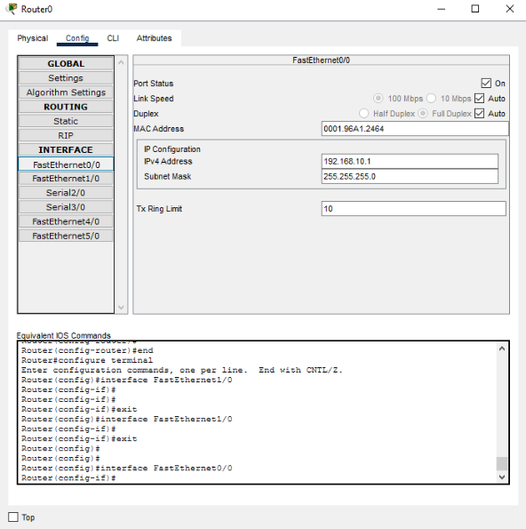

# Отчёт по практической работе в Cisco Packet Tracer
Билет 1
## 1.Топология сети

В ходе работы была создана сеть, состоящая из следующих устройств:
- PC1 — первый компьютер;
- PC2 — второй компьютер;
- Switch2 — коммутатор;
- R1 — маршрутизатор;
- Server0 — сервер DNS и HTTP.

Компьютеры подключены к коммутатору который соединён с маршрутизатором. Маршрутизатор подключён к серверу.

## 2. Адресации

Для локальной сети использована подсеть `192.168.10.0/24`, а для сети сервера — `192.0.2.0/24`.

| Устройство | IP-адрес | Маска |
|---|---|---|
| Router0 | 192.168.10.1 | 255.255.255.0 |
| PC1 | 192.168.10.11 | 255.255.255.0 |
| PC2 | 192.168.10.12 | 255.255.255.0 |
| Server0 | 192.0.2.10 | 255.255.255.0 |

## 4. Настройка маршрутизатора

Router0 был настроен:
- GigabitEthernet1/0 с адресом 192.168.10.1;
- GigabitEthernet2/1 с адресом 192.0.2.1.

## 5. Настройка сервера

Серверу Server0 назначен статический IP-адрес `192.0.2.10`, маска `255.255.255.0`, шлюз `192.0.2.1`.

На сервере настроен DNS с записью www.wek.test

## 6. Проверка сети

Топология:

Мас таблица из комутатора:

Таблица маршрутов:

Ручная настройка ip на интерфейсе к которому подключён pc1

## 7. Карта инкапсуляции пакета от ПК до сервера по уровням OSI/TCP-IP.
PC1: 192.168.10.11

* Шлюз Router0: 192.168.10.1
* Server0: 192.0.2.10
* Протокол приложения: HTTP
* Транспортный протокол: TCP
